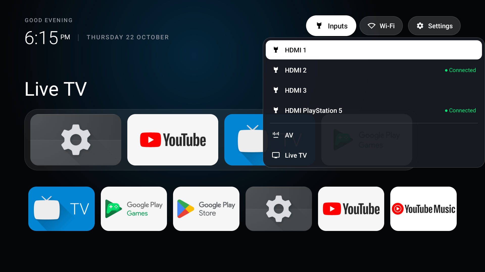

# GalVis TV Launcher

**GalVis** is a minimalist, debloated, high-performance Android TV launcher inspired by the aesthetics of Apple TV (tvOS) and [CleanYourTV](https://github.com/Gathin23/cleanyourtv). Built specifically for memory-conscious Google TV devices such as the **TCL 55C635**, it eliminates sponsored rows, recommendation feeds, and vendor bloat while preserving smooth 60 fps remote navigation.

---

## Visual Showcase

| Home Screen & Ambient Glow | Anchored Inputs Flyout Menu |
|:---:|:---:|
|  |  |

---

## Key Features

- **Apple TV-Style Frosted Dock**: A centered, rounded band housing your 4 primary favorite applications.
- **4-Column Clean Alignment**: The lower application grid features 4 columns with `180dp x 102dp` cards aligned directly under the 4 dock cards, matching the hero layout from [CleanYourTV](https://cleanyour.tv/).
- **Top Shelf Title & Dynamic Ambient Glow**: Displays the active application title in large bold type left-aligned to the dock, accompanied by a dynamic radial backdrop glow tinted to match the app's brand artwork via AndroidX Palette.
- **Full-Bleed 16dp Masked Tiles**: App banners (YouTube, Play Store, Prime, etc.) fill the entire tile surface edge-to-edge without letterboxing or empty black borders, clipped to a 16dp rounded mask.
- **Multi-Layer Floating Glass Highlight**: 4-layer composite focus rim (contrast drop shadow, radiant ice-blue bezel, diamond-white core, and specular glass glare) with 160ms physical spring bounce (`OvershootInterpolator(1.35f)`).
- **Anchored Inputs Flyout Menu**: A frosted glass dropdown anchored directly under the `Inputs` header pill, allowing instant switching between HDMI 1–3, PlayStation 5, AV, and Live TV with real-time connection status dots.
- **Header Pill Focus Inversion**: Compound drawables and text on frosted pill buttons (`Inputs`, `Wi-Fi`, `Settings`) synchronously invert from white to solid pitch-black (`#000000`) when focused.
- **Smart App Label Reveal**: Dock items use the top shelf for naming, while lower-grid tiles reveal clean labels underneath only when focused.
- **Zero-Bloat Performance**: Written in native Kotlin and AndroidX Views (`RecyclerView`) rather than Jetpack Compose for TV to ensure fluid 60 fps navigation within the 2 GB RAM budget of the TCL 55C635.
- **Preserved Cast Ecosystem**: Operates as a pure launcher activity; Google Cast and Chromecast built-in remain 100% operational in the background.

---

## Technical Specifications

| Parameter | Specification |
|---|---|
| **Language** | Kotlin 1.9.x |
| **Minimum SDK** | Android 8.0 (API 26) |
| **Target SDK** | Android 14 (API 34) |
| **UI Framework** | AndroidX Views + Material Components (`ConstraintLayout`, `RecyclerView`, `MaterialCardView`) |
| **Color Extraction** | AndroidX Palette KTX |
| **Target Device** | TCL 55C635 (Google TV / Android TV 11, RT51M / RT2872 chipset, 2 GB RAM) |
| **Testing Target** | Android TV Emulator (`Television_1080p`, 1920x1080 @ 320 DPI) |

---

## Project Structure

```text
android-tv/
├── galvis/                       # Android Studio / Gradle Project
│   ├── app/
│   │   ├── src/main/java/com/galvis/launcher/
│   │   │   ├── adapter/AppAdapter.kt          # Dual-mode dock & grid adapter
│   │   │   ├── data/AppRepository.kt          # Leanback & TV input discovery
│   │   │   ├── model/AppItem.kt               # App entity definition
│   │   │   ├── ui/FocusScaleHelper.kt         # 140ms D-pad focus spring physics
│   │   │   └── MainActivity.kt                # Main home orchestrator & glow engine
│   │   └── src/main/res/
│   │       ├── layout/activity_main.xml       # Top console, shelf, dock, & grid
│   │       ├── layout/item_dock_app.xml       # 180x102dp full-bleed dock card
│   │       ├── layout/item_grid_app.xml       # Full-bleed grid card with smart label
│   │       ├── layout/popup_inputs_menu.xml   # Anchored inputs flyout layout
│   │       └── drawable/                      # Frosted glass shapes & focus rim
├── docs/
│   └── images/                   # Verification screenshots
├── samples/                      # CleanYourTV reference designs
├── CHANGELOG.md                  # Project versioning and history
└── README.md                     # Project overview and setup guide
```

---

## Building and Running

### Prerequisites

- **Java Development Kit**: OpenJDK 21 LTS (`C:\Program Files\Microsoft\jdk-21.0.12.101-hotspot` or equivalent).
- **Android SDK**: Build tools 34.0.0 and Platform 34.

### Build via Command Line (PowerShell)

```powershell
$env:JAVA_HOME = "C:\Program Files\Microsoft\jdk-21.0.12.101-hotspot"
cd galvis
.\gradlew.bat assembleDebug
```

The compiled APK will be located at:
`galvis/app/build/outputs/apk/debug/app-debug.apk`

---

## Deployment Instructions

### 1. Deploying to the Android TV Emulator

Verify the emulator is connected via ADB:
```powershell
adb devices
```

Install and launch GalVis:
```powershell
adb -s emulator-5554 install -r galvis/app/build/outputs/apk/debug/app-debug.apk
adb -s emulator-5554 shell am start -n com.galvis.launcher.debug/com.galvis.launcher.MainActivity
```

### 2. Deploying to the Physical TCL 55C635 Google TV

1. **Enable Developer Options on TCL TV**:
   - Go to **Settings** > **System** > **About**.
   - Scroll down to **Android TV OS build** and click the `OK` button on the remote 7 times until you see *"You are now a developer!"*.
2. **Enable Network USB Debugging**:
   - Go to **Settings** > **System** > **Developer options**.
   - Turn on **USB debugging**.
3. **Connect via Wireless ADB**:
   - Verify TV is on the same local network (`192.168.31.124`):
   ```powershell
   adb connect 192.168.31.124:5555
   ```
   - On the TV screen, accept the *"Always allow from this computer"* prompt.
4. **Install GalVis on the TV**:
   ```powershell
   adb -s 192.168.31.124:5555 install -r galvis/app/build/outputs/apk/debug/app-debug.apk
   adb -s 192.168.31.124:5555 shell am start -n com.galvis.launcher.debug/com.galvis.launcher.MainActivity
   ```

---

## Remote / D-Pad Navigation

- **DPAD_UP**: Moves focus from dock to the header pills (`Inputs`, `Wi-Fi`, `Settings`).
- **DPAD_DOWN**: Moves focus from header to dock, or from dock into the all-apps grid (revealing app labels).
- **DPAD_CENTER / OK**:
  - On an app tile: Launches the application.
  - On the `Inputs` button: Opens the anchored flyout menu.
  - Inside the Inputs menu: Tunes the selected HDMI port / Live TV.
- **LONG_CLICK (Hold OK)**: Pins or unpins an application from the Favorites dock band.
- **BACK**: Dismisses the active Inputs popup, or returns focus directly to the Favorites dock.
