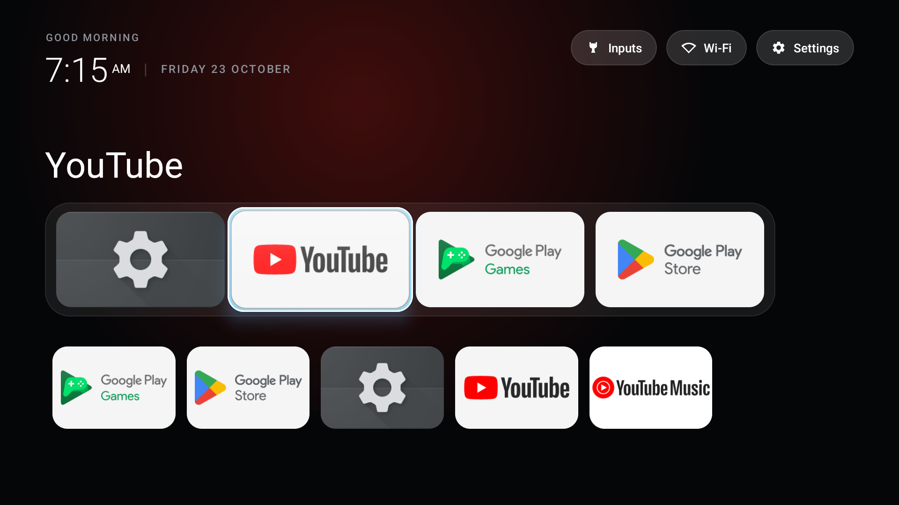
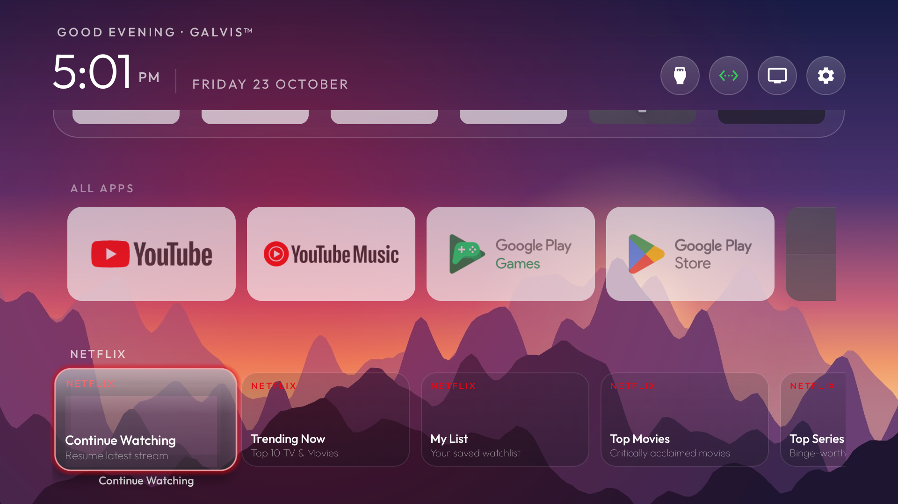
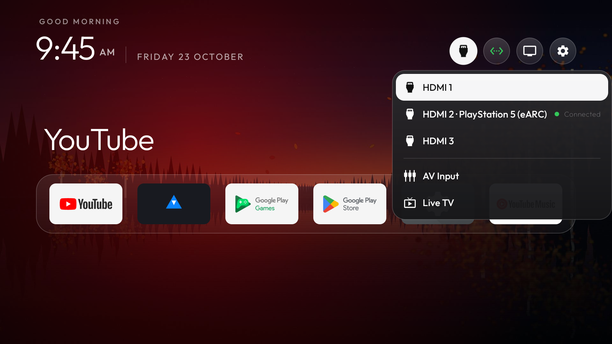

# GALVis™ TV Launcher

<p align="center">
  
</p>

**GALVis™** is an ultra-minimalist, high-performance Android TV & Google TV launcher that eliminates sponsored rows, recommendation feeds, and vendor bloat while preserving smooth 60 fps remote navigation. Built on a rock-solid, zero-bloat foundation with a compiled footprint of just **474 KB**, GALVis™ is engineered specifically for memory-conscious televisions such as the **TCL 55C635** (2 GB RAM, Cortex-A55).

---

## Visual Showcase

| Home Screen & 6-Column Dock | Horizontal Shelf Rewind Loop | Inputs & Connectivity Flydown |
|:---:|:---:|:---:|
|  |  |  |

---

## The Signature GALVis™ Theme Mashup

GALVis™ features a unified hybrid theme combining the best visual characteristics across three design systems:

1. **Glass Theme Overlays & App Glow**:
   - `dock_glass: true`: Frosted translucent dock band allowing wallpapers and backdrop gradients to shine through.
   - `dock_opacity: 70`: 70% opacity for delicate atmospheric depth.
   - `app_glow: true`: Dynamic halo glow that extracts the active app's dominant brand color and bathes the tile in vibrant light.
   - `advanced_effects: true`: Lifted card elevation with hardware-accelerated ambient shadows.
2. **Ruska Landscape & Mood**:
   - `wallpaper: true` + `wallpaper_true_color: true`: Finnish autumn dusk wallpaper over a calm lake, rendered with 32-bit color precision to prevent color banding.
   - `background_color: "#07080D"`: Deep, comfortable midnight twilight palette.
3. **Six-Column Expansive Grid**:
   - `columns: 6`: Compact 6-item card row providing fast, direct access to more apps.
   - `rows_below_dock: 1`: One grid row peeks out beneath the dock, giving immediate visual anticipation of installed apps.
4. **Minimalist Icon-Only Header**:
   - `icon_only_buttons: true` & `icon_only_inputs: true`: Inputs, Wi-Fi, and Settings appear as round, frosted icon buttons with **zero text clutter**.
   - `wifi_status_color: true`: Subtle emerald green state when online.
   - `focus_overshoot: true`: Authentic Apple TV tvOS spring bounce physics on D-pad navigation.
5. **Horizontal Shelves & Analog Tape-Rewind Loop**:
   - Fluid horizontal content shelves (*All Apps*, *Netflix*, *YouTube*, *Disney+*).
   - Pressing `DPAD_RIGHT` on the last shelf card smoothly rewinds the carousel to Card 0 (~350ms) while the floating glass highlight glides gracefully back without escaping to top buttons or adjacent rows. See detailed documentation in [Horizontal Shelf Rewind & Glass Alignment Specification](docs/horizontal-shelf-rewind-and-glass-alignment.md).

---

## Technical Specifications

| Parameter | Specification |
|---|---|
| **Package** | `com.galvis.tvhome` |
| **APK Footprint** | **474 KB** (sub-500 KB, ProGuard/R8 optimized) |
| **Minimum SDK** | Android 8.0 (API 26) |
| **Target SDK** | Android 14 (API 34) |
| **UI Framework** | Pure Java + AndroidX RecyclerView + DynamicAnimation |
| **Theme Engine** | Hot-swappable JSON overlays (`config.json` + `wallpaper.jpg`) |
| **Target Device** | TCL 55C635 (Google TV / Android TV 11, RT51M / RT2872 chipset, 2 GB RAM) |
| **Testing Target** | Android TV Emulator (`Television_1080p`, 1920x1080 @ 320 DPI) |

---

## Project Structure

```text
android-tv/
├── galvis/                       # Android Studio / Gradle Project
│   ├── app/
│   │   ├── src/main/java/com/galvis/launcher/
│   │   │   ├── adapter/AppAdapter.kt          # Dual-mode dock & grid adapter
│   │   │   ├── data/AppRepository.kt          # Leanback & TV input discovery
│   │   │   ├── model/AppItem.kt               # App entity definition
│   │   │   ├── ui/FocusScaleHelper.kt         # 140ms D-pad focus spring physics
│   │   │   └── MainActivity.kt                # Main home orchestrator & glow engine
│   │   └── src/main/res/
│   │       ├── layout/activity_main.xml       # Top console, shelf, dock, & grid
│   │       ├── layout/item_dock_app.xml       # 180x102dp full-bleed dock card
│   │       ├── layout/item_grid_app.xml       # Full-bleed grid card with smart label
│   │       ├── layout/popup_inputs_menu.xml   # Anchored inputs flyout layout
│   │       └── drawable/                      # Frosted glass shapes & focus rim
├── docs/
│   └── images/                   # Verification screenshots
├── samples/                      # CleanYourTV reference designs
├── CHANGELOG.md                  # Project versioning and history
└── README.md                     # Project overview and setup guide
```

---

## Building and Running

### Prerequisites

- **Java Development Kit**: OpenJDK 21 LTS (`C:\Program Files\Microsoft\jdk-21.0.12.101-hotspot` or equivalent).
- **Android SDK**: Build tools 34.0.0 and Platform 34.

### Build via Command Line (PowerShell)

```powershell
$env:JAVA_HOME = "C:\Program Files\Microsoft\jdk-21.0.12.101-hotspot"
cd galvis
.\gradlew.bat assembleDebug
```

The compiled APK will be located at:
`galvis/app/build/outputs/apk/debug/app-debug.apk`

---

## Deployment Instructions

### 1. Deploying to the Android TV Emulator

Verify the emulator is connected via ADB:
```powershell
adb devices
```

Install and launch GalVis:
```powershell
adb -s emulator-5554 install -r galvis/app/build/outputs/apk/debug/app-debug.apk
adb -s emulator-5554 shell am start -n com.galvis.launcher.debug/com.galvis.launcher.MainActivity
```

### 2. Deploying to the Physical TCL 55C635 Google TV

1. **Enable Developer Options on TCL TV**:
   - Go to **Settings** > **System** > **About**.
   - Scroll down to **Android TV OS build** and click the `OK` button on the remote 7 times until you see *"You are now a developer!"*.
2. **Enable Network USB Debugging**:
   - Go to **Settings** > **System** > **Developer options**.
   - Turn on **USB debugging**.
3. **Connect via Wireless ADB**:
   - Verify TV is on the same local network (`192.168.31.124`):
   ```powershell
   adb connect 192.168.31.124:5555
   ```
   - On the TV screen, accept the *"Always allow from this computer"* prompt.
4. **Install GalVis on the TV**:
   ```powershell
   adb -s 192.168.31.124:5555 install -r galvis/app/build/outputs/apk/debug/app-debug.apk
   adb -s 192.168.31.124:5555 shell am start -n com.galvis.launcher.debug/com.galvis.launcher.MainActivity
   ```

---

## Remote / D-Pad Navigation

- **DPAD_UP**: Moves focus from dock to the header pills (`Inputs`, `Wi-Fi`, `Settings`), or from lower horizontal shelves to the row above.
- **DPAD_DOWN**: Moves focus from header to dock, or down into horizontal shelves (*All Apps*, *Netflix*, *YouTube*, *Disney+*).
- **DPAD_LEFT / DPAD_RIGHT**: Navigates horizontally across shelf cards. At the end of any horizontal shelf, pressing `DPAD_RIGHT` smoothly tape-rewinds the carousel back to the first card (`index 0`) with the glass highlight gliding gracefully back.
- **DPAD_CENTER / OK**:
  - On an app tile: Launches the application.
  - On the `Inputs` button: Opens the anchored flyout menu.
  - Inside the Inputs menu: Tunes the selected HDMI port / Live TV.
- **LONG_CLICK (Hold OK)**: Pins or unpins an application from the Favorites dock band.
- **BACK**: Dismisses active flyout menus, or returns focus directly to the Favorites dock.
