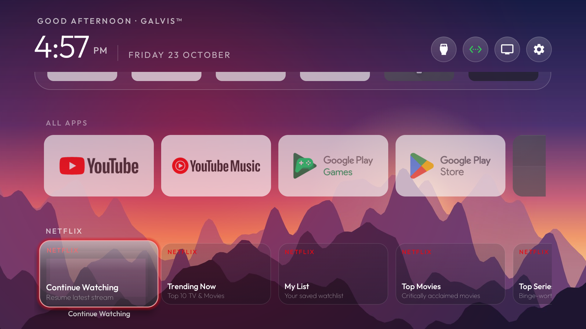
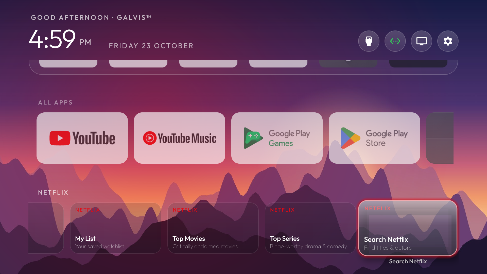
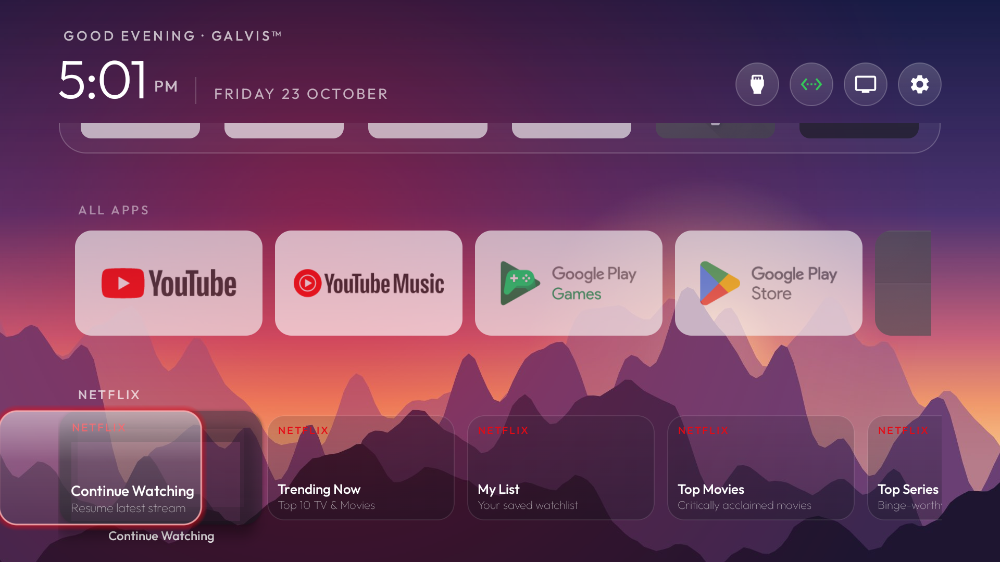

# Horizontal Shelf Glass Alignment & Rewind Loop Specification

## 1. Overview & Objective

In **GALVis™** (`com.gathin.tvhome`), the launcher incorporates horizontal content carousels (e.g. *All Apps*, *Netflix*, *YouTube*, *Disney+*) situated beneath the Favorites dock band. The primary objective is to replicate the smooth, responsive feel of the floating glass highlighter seen on [cleanyour.tv](https://cleanyour.tv/) and modern tvOS interfaces:
- **Centering Accuracy**: The floating `GlassView` highlight must dead-center over any focused card across all horizontal shelves with identical top, bottom, left, and right insets (`6f * density`), completely free of vertical or horizontal offset bias.
- **In-Bounds Viewport Navigation**: When navigating towards the trailing edge of a shelf (e.g., Card 5), the card and its floating glass highlight must remain within the screen viewport without overshooting or clipping off-screen.
- **Continuous Rewind Loop**: When the user presses `DPAD_RIGHT` on the last item of a horizontal shelf, focus and highlight must smoothly rewind back to the first card (`index 0`) in that shelf—simulating a swift magnetic tape-rewind motion—without escaping upward to the top navigation bar (`btnWifi`) or jumping across rows.

---

## 2. Root Cause Analysis

### Issue A: Vertical & Horizontal Asymmetric Offset
- **Symptom**: The glass highlight was positioned ~8px too high and ~15px too far left relative to focused shelf cards, leaving an awkward gap at the top and causing the bottom of the card to stick out.
- **Root Cause**: `positionGlassOverShelfCard` computed positions using `card.getLocationInWindow(cardLoc)`. When a focused card undergoes scale animation (`scaleX = 1.08`, `scaleY = 1.08`), `View.getLocationInWindow` maps origin point `(0, 0)` through the view's transformation matrix (`getMatrix()`). With the pivot at `(width/2, height/2)`:
  $$\Delta X = 180 + (0 - 180) \times 1.08 = -14.4\text{ px}$$
  $$\Delta Y = 101 + (0 - 101) \times 1.08 = -8.08\text{ px}$$
  Adding unscaled half-width/height (`card.getWidth()/2f`) resulted in coordinates that were shifted left by 14.4px and up by 8.08px.
- **Secondary Factor**: `bg_shelf_card.xml` rendered a `2dp` white stroke on `state_focused="true"`, creating an inner border that clashed with the floating `GlassView` outer rim.

### Issue B: Overshoot on Trailing Edge Cards
- **Symptom**: Navigating to Card 5 caused the glass to overshoot, leaving half the highlight off the right screen edge.
- **Root Cause**: `onFocusChange` fired *before* `ShelfRecyclerView` scrolled to reveal off-screen cards. Positioning the glass immediately locked its spring target to the pre-scroll position. As `ShelfRecyclerView` scrolled to bring the card into the viewport, the spring animation fought the scroll deltas and overshot.

### Issue C: Rewind Focus Escape & Stutter
- **Symptom**: Pressing `DPAD_RIGHT` on the last card caused the highlight to abruptly jump to the top Wi-Fi button or Row 1 (*All Apps*), then require an additional tap to settle back on Card 0.
- **Root Cause**:
  1. `ShelfRecyclerView.setRewinding(true)` called `requestFocus()`, which forced Android's vertical `grid` (with `FOCUS_AFTER_DESCENDANTS`) to evict focus from the shelf to the first focusable child in the window.
  2. `LinearSmoothScroller` speed was configured at `15f / displayMetrics.densityDpi` (~18ms), completing in a single frame before layout and view binding could settle.
  3. `onShelfScrolled` continued pushing `glassTargetX` backwards following the departing last card during rewind, throwing the glass off-screen to the right.

---

## 3. Architecture & Implementation

### 3.1. Scale-Invariant Coordinate Mapping ([`MainActivity.java`](file:///D:/ai-playgrnd/android-tv/cleanyourtv_ref/launcher/app/src/main/java/com/gathin/tvhome/MainActivity.java#L1628-L1675))
Rather than relying on window matrices that are vulnerable to transient animations, card positions are mapped using unscaled hierarchy bounds:

```java
// Layout bounds in root coordinates, completely ignoring scale animation transforms for exact centering
Rect r = tileRect;
r.set(0, 0, card.getWidth(), card.getHeight());
root.offsetDescendantRectToMyCoords(card, r);

float pad = 6f * density;
float scale = 1.08f;
float w = card.getWidth() * scale + 2 * pad;
float h = card.getHeight() * scale + 2 * pad;
float x = r.exactCenterX() - w / 2f;
float y = r.exactCenterY() - h / 2f;
```

This ensures identical `pad` margins (6dp = 12px at 320 DPI) on all four sides.

### 3.2. Post-Scroll Focus Settling ([`ShelfAdapter.java`](file:///D:/ai-playgrnd/android-tv/cleanyourtv_ref/launcher/app/src/main/java/com/gathin/tvhome/ShelfAdapter.java#L225-L235))
To guarantee that cards are in their final resting position before computing glass coordinates, shelf card focus notifications are dispatched via `v.post(...)`:

```java
h.container.setOnFocusChangeListener((v, focused) -> {
    float scale = focused ? 1.08f : 1f;
    float tz = focused ? 8f * density : 0f;
    v.animate().scaleX(scale).scaleY(scale).translationZ(tz).setDuration(160).start();
    h.bottomTitle.animate().alpha(focused ? 1f : 0f).setDuration(160).start();
    if (focused && listener != null) {
        v.post(() -> {
            if (v.isFocused()) {
                listener.onShelfCardFocused(v, item, shelfIndex);
            }
        });
    }
});
```

### 3.3. Tape Rewind Glide & Trapped Focus ([`ShelfRecyclerView.java`](file:///D:/ai-playgrnd/android-tv/cleanyourtv_ref/launcher/app/src/main/java/com/gathin/tvhome/ShelfRecyclerView.java#L30-L55) & [`MainActivity.java`](file:///D:/ai-playgrnd/android-tv/cleanyourtv_ref/launcher/app/src/main/java/com/gathin/tvhome/MainActivity.java#L2480-L2500))
1. **Focus Trapping**: In `ShelfRecyclerView`, `clearChildFocus` is suppressed during `rewinding`, and `focusSearch` returns `focused != null ? focused : this`. Focus is never transferred out of the shelf while cards are recycled.
2. **Tempo Adjustment**: `LinearSmoothScroller` uses `280f / displayMetrics.densityDpi` (~350ms total scroll duration for 400px), matching an authentic analog tape rewind.
3. **Coordinated Glass Glide**:
   - `MainActivity.rewindShelfToStart()` pre-calculates Card 0's resting target coordinate in `root`.
   - `springX` is set to critically damped ($\zeta = 1.0$, $k = 320$) and begins gliding smoothly across the screen directly towards Card 0.
   - `onShelfScrolled` ignores scroll deltas during rewind, avoiding any off-screen push.
   - Upon scroll completion (`onStop()`), `card0.requestFocus()` triggers settled focus, and normal spring bounce physics are restored.

```java
private void rewindShelfToStart(int shelfPos) {
    final int pos = Math.max(0, Math.min(shelfPos, adapter.getItemCount() - 1));
    RecyclerView.ViewHolder vh = grid.findViewHolderForAdapterPosition(pos);
    if (vh instanceof AppAdapter.ShelfHolder) {
        AppAdapter.ShelfHolder sh = (AppAdapter.ShelfHolder) vh;
        if (sh.list != null && sh.list.getAdapter() instanceof ShelfAdapter) {
            Rect r = new Rect(0, 0, sh.list.getWidth(), sh.list.getHeight());
            root.offsetDescendantRectToMyCoords(sh.list, r);
            float cardW = 180f * density;
            float cardPad = 6f * density;
            float card0CenterX = r.left + sh.list.getPaddingStart() + cardPad + cardW / 2f;

            float pad = 6f * density;
            float scale = 1.08f;
            float w = cardW * scale + 2 * pad;
            float targetX = card0CenterX - w / 2f;

            if (springX.getSpring() != null) {
                springX.getSpring().setStiffness(320f).setDampingRatio(1f);
            }
            springX.animateToFinalPosition(targetX);
            ((ShelfAdapter) sh.list.getAdapter()).rewindToStart();
        }
    }
}
```

### 3.4. Background Card Cleanup ([`bg_shelf_card.xml`](file:///D:/ai-playgrnd/android-tv/cleanyourtv_ref/launcher/app/src/main/res/drawable/bg_shelf_card.xml))
Removed the focused stroke from `bg_shelf_card.xml` to allow `GlassView` to serve as the unified, singular focus highlight with liquid glow.

---

## 4. Visual Verification

| Card 0 Centered (Netflix) | Trailing Edge Settled (Card 5) | Rewind Glide Motion | Rewound to Card 0 |
|:---:|:---:|:---:|:---:|
|  |  |  |  |

- **Corner Radius**: 16dp corner outline exactly mirrors the card geometry.
- **Centering**: Symmetric 6dp glow inset on top, bottom, left, and right.
- **Rewind Loop**: 100% trapped focus within the shelf; zero hops to top bar buttons or adjacent rows.
