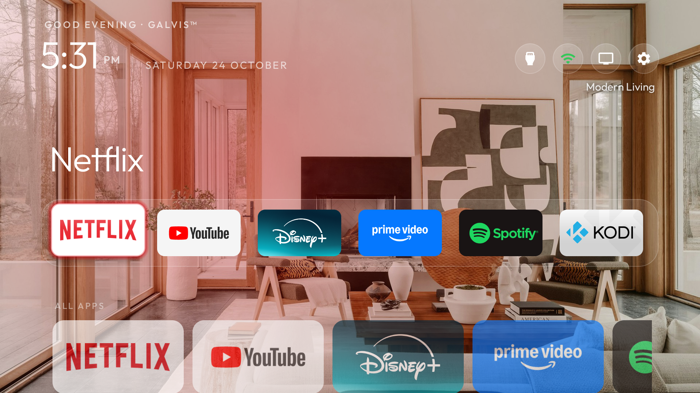

# GALVis TV Home 📺

<p align="center">
  
</p>

<p align="center">
  <a href="https://github.com/your-username/galvis/releases"></a>
  <a href="https://developer.android.com/about/versions"></a>
  <a href="LICENSE"></a>
  <a href="PRIVACY.md"></a>
  <a href="https://buymeacoffee.com/yourusername"></a>
  <a href="https://ko-fi.com/yourusername"></a>
</p>

---

## 🌟 Overview

**GALVis TV Home** is a lightweight, high-performance, ad-free Home screen launcher engineered specifically for Android TV and Google TV devices (TCL, Sony Bravia, Chromecast with Google TV, Hisense, Xiaomi, NVIDIA Shield).

Modern TV operating systems have become cluttered with advertisements, algorithmic recommendations, autoplaying trailers, and background telemetry that slow down budget and mid-tier TV processors. GALVis strips all of that away, returning your television to a fast, clean, and customizable media hub.

### ✨ Key Features

- **🚀 Instantaneous Boot & Low Memory Footprint**: Pure Java 17 architecture with AndroidX `RecyclerView` and `DynamicAnimation`. APK size is under **3.2 MB** (including bundled 1080p photographic wallpapers) and consumes less than **25 MB RAM** in background standby.
- **🧊 Frosted Glass Dock**: Configurable 6-column quick-launch dock with subtle backdrop blur, translucent glass cards, and soft amber focus glow.
- **🌄 Curated Landscape Photographic Wallpapers**: Pre-bundled with 5 lossless 1080p landscape photographs (*Pine Sprout, Fairy Glen, Modern Living, Oregon Coast, Alpine Lake*) rotating automatically every 10 minutes with smooth fade transitions and dynamic caption overlays.
- **☀️ Day/Night Solar Tinting**: Optional astronomical calculation calculates sunrise and sunset based on coarse local coordinates, applying warm daytime or cool midnight tint filters.
- **💤 Built-in OLED/LED Clock Screensaver (`ClockDream`)**: Minimalist, anti-burn-in wandering clock screensaver.
- **🛡️ 100% Private & Offline**: Zero network requests, zero telemetry, zero analytics SDKs, and zero advertisements. All configuration stays strictly on your TV.

---

## 🎮 Remote Control Shortcuts

GALVis is designed exclusively for standard TV D-Pad directional remotes.

| Button | Action |
| :--- | :--- |
| **D-Pad Left / Right** | Navigate across apps within the current row. |
| **D-Pad Down** | Descend from the top Dock into the full Apps Grid. |
| **D-Pad Up** | Move up from the grid back to the Dock, or jump to top Status Bar. |
| **Center / OK** | Launch highlighted application or input source. |
| **Long-Press Center / OK** | Open App Context Menu (Pin/Unpin to Dock, Hide App, App Info, Uninstall). |
| **Menu Button** | Open GALVis Settings Overlay. |
| **Back Button** | Smoothly rewind cursor back to the primary favorite app. |

---

## 🚀 Quick Start & Installation

### Option 1: Sideloading via ADB (Recommended)

1. Enable **Developer Options** and **USB / Network Debugging** on your TV (*Settings → System → About → click "Android TV OS Build" 7 times*).
2. Connect to your TV over Wi-Fi:
   ```bash
   adb connect <TV_IP_ADDRESS>:5555
   ```
3. Install the release APK:
   ```bash
   adb install -r galvis/app/build/outputs/apk/release/app-release.apk
   ```
4. Grant optional location permission for astronomical day/night wallpaper tinting:
   ```bash
   adb shell pm grant com.galvis.tvhome android.permission.ACCESS_FINE_LOCATION
   ```

### Option 2: Sideloading via "Downloader" App or USB Flash Drive

1. Copy `app-release.apk` to a USB flash drive formatted as FAT32.
2. Insert the drive into your TV's USB port and install using any file manager (e.g. *File Commander* or *Downloader* by AFTVnews).

---

## 📺 Making GALVis the Default Home Screen

Google TV devices (such as TCL, Chromecast 4K, and Sony) enforce system-level priority on the stock launcher (`com.google.android.apps.tv.launcherx`). To make GALVis your permanent launcher across reboots:

### Step 1: Set GALVis as the Default Home Activity
```bash
adb shell cmd package set-home-activity --user 0 com.galvis.tvhome/.MainActivity
```

### Step 2: Disable Stock Google TV Launchers
```bash
adb shell pm disable-user --user 0 com.google.android.apps.tv.launcherx
adb shell pm disable-user --user 0 com.google.android.tungsten.setupwraith
```

### Step 3: (Optional) Set the Minimalist Screensaver
```bash
adb shell settings put secure screensaver_components com.galvis.tvhome/.ClockDream
adb shell settings put secure screensaver_enabled 1
```

> **Note on Persistence**: The `pm disable-user` command modifies `/data/system/users/0/package-restrictions.xml` on Android. It **persists across cold restarts, power cycles, and sleep modes**. It only reverts if you perform a full factory reset or re-enable the package manually.

### ↩️ Rollback to Stock Google TV (Safety Command)
If you ever want to revert completely to the factory Google TV launcher, run:
```bash
adb shell pm enable --user 0 com.google.android.apps.tv.launcherx
adb shell pm enable --user 0 com.google.android.tungsten.setupwraith
adb shell cmd package set-home-activity --user 0 com.google.android.apps.tv.launcherx/.home.HomeActivity
```

---

## 🛠️ Building From Source

### Prerequisites
- JDK 17 (Java Development Kit)
- Android SDK (API 34)

### 1. Build Sideloadable Release APK
```bash
cd galvis
./gradlew assembleRelease
```
The optimized, R8-minified APK will be generated at `app/build/outputs/apk/release/app-release.apk`.

### 2. Build Google Play Store App Bundle (.aab)
```bash
./gradlew bundleRelease
```
The App Bundle will be generated at `app/build/outputs/bundle/release/app-release.aab`.

### 3. Release Signing Configuration
To sign your release builds with your official upload key:
1. Copy `keystore.properties.example` to `keystore.properties`.
2. Fill in your keystore path, alias, and passwords.
3. Run `./gradlew bundleRelease` — Gradle will automatically detect `keystore.properties` and sign the output bundle.

---

## ☕ Support the Project

GALVis is open-source, ad-free, and independently developed. If GALVis gave your television a faster, cleaner life, consider supporting future development:

- ☕ **Buy Me A Coffee**: [buymeacoffee.com/yourusername](https://buymeacoffee.com/yourusername)
- 🥐 **Ko-fi**: [ko-fi.com/yourusername](https://ko-fi.com/yourusername)
- ⭐ **Star the Repository**: Starring this repository on GitHub helps more Android TV users discover it!

---

## 📄 License & Privacy

- **Software License**: Distributed under the [GNU General Public License v3.0 (GPLv3)](LICENSE).
- **Font License**: The *Outfit* typeface is licensed under the [SIL Open Font License 1.1](FONT-LICENSE-OFL.txt).
- **Privacy Policy**: Read our zero-telemetry guarantee in [PRIVACY.md](PRIVACY.md).
